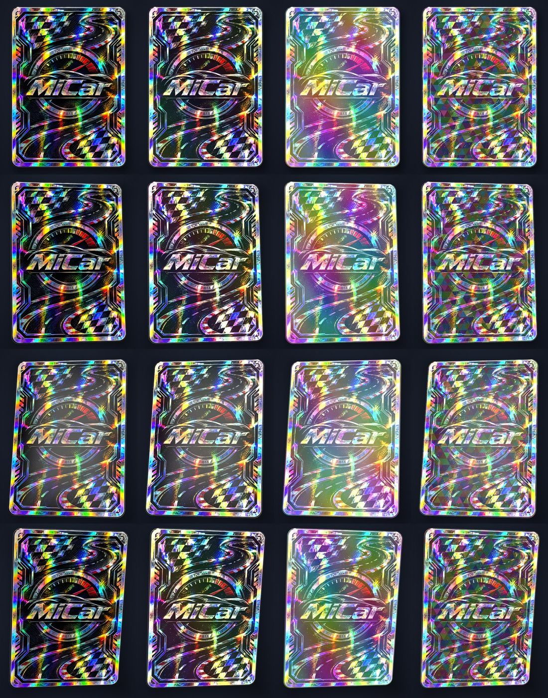
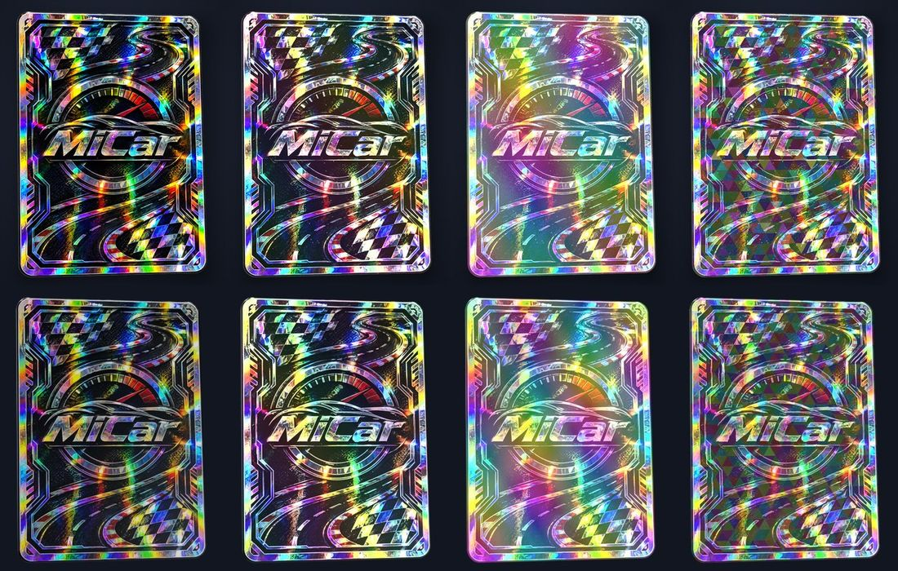
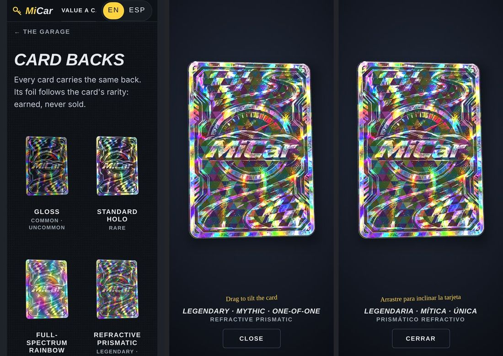

# The holographic card back — design

Date: 2026-11-11
Status: design approved in conversation and built on the branch `claude/holo-card`. The look was approved from a preview in the owner's Blender session (four cards, one per foil); the browser's card was then tuned against Blender's stills. It has been run in desktop Chrome with software GL only. Nothing here has been judged on a phone yet. Where the build differs from the approved design, the text below says what was built, and the differences are listed under "As built" at the end.

## What this is

Every MiCar collectible card gets a trading-card back: the owner's MiCar card-back artwork, shown as a physical card in 3D whose foil answers the card's real angle. Which foil it carries follows the card's rarity. The first place a visitor meets it is an inspect view on each car's page in the Garage.

Three things are true throughout:

- **The artwork is never edited.** No redrawing, regenerating, recolouring or cropping. The foil is light added on top of it by a shader. At rest, with no foil, the face is the artwork itself; the gloss shows when the card is tilted toward the light.
- **The engine is not touched.** Rarity is read from `card.rarity.tier` as `@micar/engine` already works it out. No card-race logic, no vehicle statistic and no grade formula changes.
- **Foil is still never for sale.** The slab's front keeps its finish, earned by the grade, exactly as today. The back's foil is earned by rarity. Both are earned; neither can be bought.

This supersedes one line of `docs/micar-garage-product-spec.md` ("Card back: the closed garage door, universal"): the back is now this artwork. The rear label of the slab (the grade report) is unchanged and is still what the card flips to.

## What the visitor sees

1. **On a car's page** (`#/garage/<MiCar ID>`), under the card and its hint, a button: "Card back".
2. **The inspect view.** A full-screen dark backdrop with the card back large in the middle, the card's rarity and the foil's name under it, a hint ("Drag to tilt the card") and a Close button. A finger or the mouse tilts the card up to 16 degrees each way; the side under the finger moves away, as the slab on the page already does. The foil's colour, highlights, facets and sparkles change with the angle. On release the card springs back flat and the picture stops redrawing.
3. **Close** by the button or Escape. It is a native modal dialog, so focus is held inside it and returns to the "Card back" button afterwards.
4. **The four backs** (`#/garage/card-backs`): one page showing all four foils side by side as stills, each opening the same inspect view with that foil. It exists so the owner can review every foil on a phone and so the browser smoke test has something to open without a parked car. Nothing links to it yet (see Open items).

## Foil by rarity

| Rarity (the engine's tier) | Foil | What it looks like |
| --- | --- | --- |
| Common, Uncommon | `gloss` | The artwork under a clear coat. No foil. |
| Rare | `holo` | Standard holographic: diagonal bands of spectral colour on the bright, metallic parts of the art. Dark areas stay dark. The subtlest step up from gloss. |
| Epic | `rainbow` | Full-spectrum rainbow: two crossing sets of bands over the whole face, dark areas included. |
| Legendary, Mythic, One-of-One | `prismatic` | Refractive prismatic: a lattice of small triangular facets, each tilted its own way so each flashes its own colour; the art is seen through the facets slightly displaced, with its colours pulled a little apart. |

The brief named Rare, Epic, Legendary and One-of-One. Mythic sits between the last two in the engine and takes prismatic with them. A tier the table does not know falls back to `gloss`, so a future tier can never show foil by accident.

On the Pages site today an owner's car tops out around Rare: higher tiers need a verified certification level or a low build number from the catalogue, and the site ships an empty verifier registry. Epic and prismatic are built, tested and shown on the four-backs page, but few parked cars will reach them yet. That is the engine's rule and this work does not loosen it.

## Decisions

1. **Blender builds the card; the browser plays it.** The card's shape (corners, bevel, thickness, the artwork's mapping) is modelled in Blender by a script and exported as a small `.glb`, the way the Strip's tracks are. Blender cannot run on a phone, so the part that reacts to a finger is a shader in the browser.
2. **Our own small WebGL renderer, no library.** A new source-only package, `@micar/holo`, in plain TypeScript like `@micar/engine` and `@micar/brand`. The value app has no three.js today and one card does not justify adding it. The package has no dependencies and no React, so the sim or a plain page can use it later.
3. **One recipe, two players.** The foil's numbers live in one table, `packages/holo/src/foils.json`. The browser shader reads it as uniforms; the Blender script reads the same file to build its preview materials. The Blender look is the reference the shader is tuned against by eye. They will be close, not identical: Blender ray-traces a studio, the shader evaluates a small procedural one.
4. **The foil answers the real angle.** Every colour comes from the half vector between the eye and one fixed key light, expressed in the card's own frame. Nothing is driven by a clock. With the card still, nothing moves.
5. **It draws only while it moves.** One frame when it is ready, frames while the spring is unsettled, one last frame when it settles, then no more `requestAnimationFrame` calls until the next touch.
6. **The inspect view takes the finger; an inline card would not.** In the full-screen view nothing scrolls behind the card, so the canvas uses `touch-action: none` and both axes tilt. The component also has a scroll-friendly mode (`touch-action: pan-y`: vertical swipes scroll the page, the card returns to flat when the browser takes the gesture) for any later use inside a scrolling page. This build uses only the first.
7. **A still stands in when WebGL cannot.** No WebGL, a failed shader, a failed download or a lost context that does not come back within two seconds: the view shows a still of that foil instead. With "reduce motion" on, the live card is drawn once, flat, and does not tilt.
8. **The master artwork is kept byte for byte.** The uploaded PNG is committed unchanged as the master, `assets/cards/micar-card-back.png` (1062 × 1481, 4.0 MB, SHA-256 `5bd441b57e7becbb812469ae4f61eebbea991c59ad955293dee80ce1852c3c95`). The site loads an AVIF encoded from it at quality 90 with full colour resolution (measured: 0.75 MB, PSNR 39.3 dB against the master), and keeps a WebP at quality 95 for a browser that cannot read AVIF (0.77 MB). WebP always halves the colour resolution, which this finely coloured artwork shows in the numbers: 43 dB on brightness but 32.5 dB over the whole picture, at any quality setting. That is why AVIF is first. Lossless would be 2.5 MB. The encode is done by a script that prints each copy's PSNR and fails under its floor.

## The card (Blender)

`tools/blender/build_card.py`, run inside Blender through the MCP connection or headless, idempotent like `build_strip.py` (it clears its own collection first). `MICAR_REPO` names the checkout, as the Strip scripts do.

- **Size.** 63.0 mm wide; height 63 × 1481 / 1062 = 87.86 mm, the artwork's own proportions, so the art is neither stretched nor cropped. 1.0 mm thick.
- **Corners.** Rounded to follow the frame drawn in the artwork, with the art's dark margin left around it: 6.75% of the width (4.25 mm), as measured. The script measures the four corners of the master and sets the radius from the smallest of them, so the cut never reaches into the frame.
- **Edge.** A 0.25 mm bevel in three segments with weighted normals, so the faces stay flat and the edge catches a clean highlight.
- **Three materials, three parts:** `face` (the master PNG itself, mapped flat, UV 0..1 across the whole image), `rim` (the bevelled metal edge) and `back`.
- **Orientation.** Upright in Blender's XZ plane facing −Y (the front view), so the glTF Y-up conversion leaves it in XY facing +Z, toward the browser's camera.
- **Look preview.** The same script builds the four preview materials from `foils.json`, a neutral studio (Blender's bundled `studio.exr`, a dark backdrop for the camera) and the four-up scene with a 96-frame tilt loop, so pressing Space shows every foil moving. View transform Standard, so the artwork's colours are shown as they are.

`tools/blender/export_card.py` writes, and fails loudly on a file over budget:

- `apps/value/public/cards/card.glb`: modifiers applied, triangulated, positions, normals and UVs, three primitives named by material, no images, no animation, no Draco. Budget 100 KB.
- `apps/value/public/cards/back-<foil>.webp`, four stills (720 × 960, transparent background, the card at a fixed small tilt): the fallback images and the tiles of the four-backs page. Budget 150 KB each.

No `.blend` is committed: the script rebuilds the scene from the master artwork.

`tools/cards/encode_art.py` (Python with Pillow) writes `apps/value/public/cards/back.avif` and `back.webp` from `assets/cards/micar-card-back.png` and prints each one's size and PSNR.

## The renderer (`packages/holo`)

Source-only, `exports` pointing at `src/index.ts`, held to the engine's source rules (`import type`, no enums, no namespaces, no parameter properties, nothing newer than ES2020) and checked by both compilers with the DOM library added.

| File | What it does | Tested by |
| --- | --- | --- |
| `foils.json`, `foils.ts` | The recipe table; `FOIL_IDS`, `FOILS`, `FOIL_LABELS`, `foilForRarity(tier)` | unit |
| `glb.ts` | Reads the one kind of `.glb` the exporter writes into typed arrays per part. Refuses anything else (bad magic, Draco, sparse accessors, a missing part) with a reason | unit, against the committed `card.glb` and hand-made buffers |
| `spring.ts` | The tilt spring: `step(state, target, dt)` and `settled(state, target)` | unit |
| `tilt.ts` | Pointer position in the canvas to target angles | unit |
| `mat.ts` | The few 4 × 4 matrix helpers needed | unit |
| `scene.ts` | The numbers sent to the GPU: the camera for a canvas shape, the card's pose, the shadow, a foil's recipe as shader vectors | unit |
| `loop.ts` | The draw-on-demand loop over an injected `requestFrame`: runs while something is moving, stops when settled | unit, with a fake frame clock |
| `shaders.ts` | The GLSL (ES 1.00, so one source serves WebGL 1 and 2) | unit for the names it shares with the renderer; browser smoke for the rest |
| `card.ts` | `createHoloCard(options)`: context, programs, the texture, pointer events, resize, context loss, `destroy()` | unit, against a stand-in canvas, context, frame clock, `fetch` and `Image`; browser smoke for the picture |
| `index.ts` | The exports | |

```ts
type FoilId = 'gloss' | 'holo' | 'rainbow' | 'prismatic';
foilForRarity(tier: string): FoilId;                    // unknown tier -> 'gloss'
webglAvailable(): boolean;
createHoloCard(options: {
  canvas: HTMLCanvasElement; meshUrl: string; artUrls: string[]; foil: FoilId;   // the first artwork the browser can decode is used
  touch?: 'capture' | 'scroll';                         // default 'scroll'
  reducedMotion?: boolean; maxPixelRatio?: number;      // default 2
  onError?: (error: Error) => void;                     // the host shows the still
}): { ready: Promise<void>; setFoil(foil: FoilId): void; resize(): void; destroy(): void };
```

**Scene.** The model is scaled so the card is one unit tall and centred. A perspective camera (24° vertical) sits on the axis, far enough that the card fills 72% of the canvas height, which leaves room for the tilt and the shadow. The canvas is 3:4, or taller: where it is too narrow for 72% of its height the card takes 84% of its width instead, so on a phone held upright the card is as large as the screen's width allows. The canvas is transparent. Pixel ratio is the device's, capped at 2.

**Tilt.** The pointer's position from the canvas centre, as a fraction of its half-size clamped to ±1, sets the target: yaw `+x × 16°`, pitch `−y × 16°` (y up), so the side under the finger moves away. The mouse tilts on hover; a finger tilts while it is down. Leaving, lifting or a cancelled gesture sets the target back to zero.

**Spring.** Per axis, `v += (k (target − x) − c v) dt; x += v dt` with `k = 170 s⁻²`, `c = 20 s⁻¹` (damping ratio 0.77: a small overshoot, no ringing), stepped at 1/120 s with the frame's time clamped to 1/30 s. Settled when both axes are within 0.02° of the target and slower than 0.05°/s; the state is then snapped to the target.

**Light and reflection.** One key light fixed in view space, up and to the left of the camera (`normalize(−0.30, 0.45, 0.84)`), the same light the Blender preview uses. A small procedural studio is evaluated along the reflection vector; no environment image is downloaded. The clear coat mirrors it sharply: a key softbox where the key light is and a narrow strip to the right, both soft-edged, in a room that is otherwise black. So with the card flat neither light is in the mirror, the coat adds nothing, and the face is the artwork itself (measured on the gloss card at rest: mean colour within 1% of the master's on a 724 × 966 canvas, and within 2.3% on the smaller canvas the smoke test uses). Tilted toward the light, the softbox slides across the card as a soft patch. The rim, and the metal under the foil, see the same studio out of focus with a low bounce and a dim room. The coat is weighted by Fresnel, so it strengthens at grazing angles. The artwork is decoded with one power function and the result encoded with its exact inverse, once, at the end.

**Shadow.** A soft rounded-rectangle shadow on a quad behind the card, drawn in the same canvas, sliding and softening a little with the tilt.

**Performance and robustness.** One context and one card at a time, created when the inspect view opens and released (`WEBGL_lose_context`) when it closes; a canvas is used for one card only. WebGL 2 where the browser has it, because it can make the smaller copies of the artwork (mipmaps) that keep it from shimmering when drawn small; WebGL 1 otherwise, without them. One texture fetch for gloss, holo and rainbow; three for prismatic. On a card drawn small the grain and the flakes are made coarser so they stay larger than a pixel. `highp` in the fragment shader where the device has it. `webglcontextlost` stops the loop and `webglcontextrestored` rebuilds; a hidden tab stops the loop. Not yet measured on a phone.

## The foil recipe

All of it is worked out in the card's own frame. `Ht` is the tangent-plane part of the half vector between the eye and the key light (x to the card's right, y up the card). `uv` runs 0..1 across the face.

- **Mask.** `mask = cover + (1 − cover) × smoothstep(m0, m1, luminance(art))`: where the foil shows. Bright, metallic art carries it; `cover` lets it onto dark art too.
- **Phase and colour.** `phase = dot(Ht, g) × K + dot(uv, d) × S + grain`; `colour = hsv(fract(phase), sat, 1)`. `K` is how fast the spectrum sweeps with the angle, `S` how many bands lie across the card, `grain` a fine noise that breaks the bands up like real foil.
- **Holo.** One set of bands, with a brightness band riding on it.
- **Rainbow.** Two crossing sets of bands, mixed 58 / 42.
- **Prismatic.** The face is cut into triangular facets `cell` millimetres across. Each facet has a random tilt `f`. Its phase uses `Ht − f × amp`, so each has its own colour; its brightness falls off with `|Ht − f × amp| / lobe`, so facets flash as the card turns; its edges are drawn as a thin line. The art is sampled at `uv + f × refr` three times with the offset scaled 0.6 / 1.0 / 1.4 for red, green and blue. The displacement fades to nothing near the card's border, so the art's frame stays crisp.
- **Sparkle.** A cell pattern of flakes, 120 across the card, on three cells in ten. Each has its own tilt and is lit only when `Ht` lines up with it. The tilts are spread around where `Ht` sits with the card flat, so every flake has an angle within the card's reach at which it lights.
- **Putting it together.** `out = art + colour × (add + mul × art) × mask × strength × shape + sparkle + coat`. Light off the foil is tinted by the ink over it (`mul`), plus a share that shows on dark ink too (`add`).

The values after tuning in the browser against the Blender stills (holo was strengthened, and the sparkle made larger and more frequent, because in the first pass neither read at a glance). `foils.json` is the truth.

| | K | S | sat | m0 – m1 | cover | strength | add | mul | sparkle | other |
| --- | --- | --- | --- | --- | --- | --- | --- | --- | --- | --- |
| holo | 4.5 | 1.6 | 0.78 | 0.12 – 0.60 | 0.03 | 1.9 | 0.45 | 1.20 | 1.0 | |
| rainbow | 6.5 | 2.6 | 0.92 | 0.05 – 0.60 | 0.46 | 1.35 | 0.52 | 1.20 | 1.0 | second set: K 5.0, S 1.9 |
| prismatic | 5.5 | 0.6 | 0.86 | 0.08 – 0.70 | 0.36 | 1.9 | 0.50 | 1.25 | 1.3 | cell 4.0 mm, refr 0.0020, amp 0.45, lobe 0.50 |

One thing learned from the preview: the artwork is itself drawn in rainbow colours, so a faint foil disappears into it. Each foil has to be strong and structured enough (bands, facets, sparkle) to read as a different material at a glance, and the comparison is checked on stills as well as in motion.

## The Garage (apps/value)

- `garage/back.ts`: the route word, which tiers carry which foil, and where the card's files are.
- `garage/HoloCard.tsx`: mounts `createHoloCard` on a canvas it makes for each mount; shows the still instead when `webglAvailable()` is false or `onError` fires; reads `prefers-reduced-motion`; shows the hint only while the card can be moved.
- `garage/CardBack.tsx`: the inspect view, a `<dialog>` opened with `showModal()`: the card, the rarity (through `RARITY_LABELS`), the foil's name, the hint, Close.
- `garage/CardBacks.tsx`: the four-backs page.
- `garage/Garage.tsx`: the "Card back" button on the car's page, and `code === 'card-backs'` shows the four-backs page before any car is looked up (a MiCar ID starts `MC-`, so the word cannot collide with one).
- `garage/garage.css`: rules under `.dp` with the `gar-` prefix, as the rest of the Garage. 44 px targets; no horizontal scroll at 375 px.
- Every new string goes through `t()` with a Spanish entry in `garage/es-card.ts` ("tarjeta", "usted"); `FOIL_LABELS` joins the `TABLES` list in `garage/es.test.ts`.
- `vite.config.ts`: `../../packages/holo/src/**/*.test.ts` joins the test `include`, so the package's tests gate every deploy the way the engine's do. No workflow file changes.

## Errors

| What goes wrong | What happens |
| --- | --- |
| The model and the artwork are still on their way | The still for that foil holds the card's place, at the live card's size, until the live card has drawn. The hint to drag it is shown only from then on |
| No WebGL, or the context cannot be made | The still for that foil. No error shown: the card back is decoration, not data |
| The `.glb` or the artwork fails to load, or the `.glb` is not what the reader expects | `onError`; the still |
| A shader fails to compile or link | `onError` with the driver's log in the console; the still |
| The context is lost | The loop stops; on restore everything is rebuilt and redrawn; if it has not come back within two seconds, `onError`; the still |
| An unknown rarity tier | `gloss` |
| The still itself fails to load | The dialog shows the rarity and foil name on the dark backdrop, and Close still works |
| A browser too old for `<dialog>` (iOS before 15.4) | The view is shown as an ordinary box over the page; its Close button closes it. Escape does not |

## Tests

- **Unit (vitest, in value's run):** the files in the table above, the renderer's whole life included (against a stand-in canvas, context, frame clock, `fetch` and `Image`); `foilForRarity` over the engine's own `RARITY_TIERS` (every tier maps, and Rare, Epic, Legendary, Mythic and One-of-One map as this document says); the three Garage components by their markup; the Spanish coverage of the new strings; the shipped files exist and are inside their budgets (`card.glb`, `back.avif`, `back.webp`, the four stills); the master artwork's SHA-256.
- **Browser smoke (`apps/value/e2e/card-back.smoke.mjs`, Playwright with software GL):** serves the built value app, opens `#/garage/card-backs`, and for each foil: the canvas draws something that is not blank; the gloss card at rest is the artwork (the right way up, not mirrored, its mean colour within 3% of the master's); two different tilts give different pixels; a foil other than gloss differs from gloss at the same tilt; after the pointer leaves, and after a cancelled touch, `requestAnimationFrame` stops being called; Close releases the context, twenty times over. Then: a lost context brings the still within three seconds; reduced motion does not tilt; no WebGL shows the still; a parked car's page opens its own card's back. Run by hand before the pull request. It is not wired into `ci.yml` in this change.
- **On a phone:** software GL says nothing about speed or about iOS Safari. Before the pull request is merged the owner tries a privately published demo page of the same component on an iPhone.

## Out of scope

- The slab's front, its grade-based finish and its CSS foil. Unchanged.
- Any change to `@micar/engine`: rarity, grade, races, stats.
- Drawing the card's front in WebGL, or turning the card from front to back in 3D.
- Tilting by the phone's gyroscope.
- Card backs in the Garage grid, in races, or for packs and reveals.
- The card or its foil inside MiCar World. The `.glb` and the package are made so the sim can use them later.
- A different material for Mythic or One-of-One than for Legendary.

## Open items

- **For the owner: link the four-backs page?** `#/garage/card-backs` works but nothing points to it. A line in the inspect view or on the Garage's examples shelf would let visitors see what each rarity carries.
- **For the owner: the look.** The first-pass values came from one preview session. Each foil's strength, band width, facet size and sparkle are meant to be tuned with the owner on the phone demo.
- **Measured later:** frame rate on an iPhone, and the shader under iOS Safari's precision rules.

## How it looks

Screenshots from the finished build, taken in desktop Chrome with software GL (not on a phone).







## As built

What differs from the design as it was approved, and why. Each was decided during the build and none changes what the visitor was promised.

- **AVIF first, WebP second** for the artwork (decision 8). The WebP alone measured 32.5 dB against the master because WebP halves colour resolution; the AVIF keeps it (39.3 dB).
- **The corner radius is 6.75% of the width**, measured from the artwork, not the 6% estimated.
- **The face's material includes the first step of the bevel**, so the artwork wraps onto the card's edge by an eighth of a millimetre.
- **WebGL 2 where the browser has it, WebGL 1 otherwise.** WebGL 2 can make smaller copies of an artwork whose size is not a power of two; without them fine detail shimmers when the card is drawn small.
- **The clear coat's studio is two soft-edged lights in a black room**, not three lights on a dark gradient. The gradient lifted the artwork's blacks at rest; now a flat gloss card is the artwork.
- **Holo is stronger and the sparkle larger and more frequent** than the first-pass numbers. Holo could not be told from gloss at a glance, and the first sparkle changed about eighty pixels on the whole card.
- **The card takes 84% of the width of a canvas too narrow for 72% of its height**, and the inspect view's stage takes the whole height of its room. On a 375 px phone the card is 288 px wide instead of 236.
- **The renderer starts one moment after it is created**, a canvas serves one card, and `destroy()` before `ready` rejects `ready` without calling `onError`. React mounts everything twice in development; a card that is made and destroyed in one breath never takes a WebGL context.
- **`scene.ts`** holds the camera, pose, shadow and foil numbers apart from `card.ts`, so they are tested without a browser. **`garage/back.ts`** is the plan's `cardBack.ts` under another name: `cardBack` and `CardBack` are the same file name on Windows and macOS.
- **The dialog closes by its button and Escape**, not by a click on the ground around the card: a drag that starts beside the card would close it by accident.
- **The hint to drag the card is shown only while the card can be dragged**: not under a still, and not with motion reduced.
- **The still also holds the card's place while the files load**, drawn at the live card's size. On a slow connection the view was otherwise empty for as long as the download took. Found by the review at the end.
- **Close works where `<dialog>` does not exist.** There the element has no `close()`, and the button would have thrown. Found by the review at the end.
- **A re-export of `card.glb` is the same model but not always the same bytes**: the rim's UVs, which nothing reads, differ in their last bit from run to run.
- **The demo is one self-contained file**, and `createHoloCard` reads a model handed over in a `data:` address without a request, so the demo can be published as a single page that asks the network for nothing.
- **The one review was done by the author** after the last task, not by a second reviewer as the plan wrote. It is weaker for that.

## The back on every card (added the same day, at the owner's request)

The owner asked for the new back on every card on the site, in place of the old one, with the rarity made plain.

- **Every card turns over to the card back.** The Garage's card (`CollectibleCard`) and the home page's card (`Slab`)
  both show `garage/BackFace.tsx` on their back face: the artwork, whole and uncropped, at half size
  (`back-face.avif`, then `back-face.webp`, written by `tools/cards/encode_art.py`), under CSS foil layers that
  follow the pointer. It is CSS, not WebGL, because a page holds dozens of cards and a browser allows only a few
  WebGL contexts. The live 3D card stays the inspect view behind the "Card back" button.
- **What the old backs showed is no longer on the card.** The Garage card's grade report is in the car's Grade tab.
  The home page card's five starting-grade bars are in the grade section below it; its "value ahead" chart is not
  shown anywhere now (`Curve` is still exported from `door/Slab.tsx`).
- **Rarity.** On the front, the rarity is a filled plate in the tier's colour and the art is framed in the same
  colour. On the back, the rarity and its foil are named under the picture, never on it.
- **The home page's card has no rarity.** It is a starting-grade card, not an engine card, so it wears the plain
  gloss back and names no rarity. Nothing in the engine was changed to give it one.
- **Not checked:** a phone. On a touch screen the holo and rainbow bands drift slowly, as the front's foil already did.
- **The four backs are on the home page.** `garage/FoilShelf.tsx`, the section after the card (`#backs`): all four
  foils side by side, each with what it is made of and the rarities that earn it, and a link to
  `#/garage/card-backs`, where each can be tilted in 3D. That page is linked from here now. The card section's
  third point no longer says the back carries the grade's categories and the chart.
- **Every card turns over, not only the big ones.** The owner's point: every slab on the site was showing a front,
  so every one has a back. `door/flip.tsx` gives each card one of three ways to turn. A tap anywhere (the default;
  a card nobody else turns keeps its own state): the small cards in the statement and the grade section, the big
  card, the Garage's examples and a car's own card. A corner button where the tap is already taken: the bay's
  showcase card, whose tap opens the inspect view. A button the page draws beside the card: a Garage tile, which is
  a link to the car. Every card carries the same yellow turn mark on its corner.
  `e2e/every-card.smoke.mjs` (`pnpm --filter @micar/value smoke:cards`) turns each of them at desktop and phone
  width; like the other browser test it is run by hand, not in CI.
- **Which face shows is said by `visibility`, not by `backface-visibility`.** On the owner's iPhone the turned card
  showed its front in a mirror and no back. Safari was drawing the turning card flat, and a flat card culls the
  wrong face. Reproduced in Chrome by forcing the card flat (`filter` on `.slab-in`); the flip now swaps the two
  faces' visibility as the card passes edge-on, which is right whether or not the browser keeps the 3D.
  `smoke:cards` has a third pass that turns every card drawn flat. Still not run on Safari itself.
